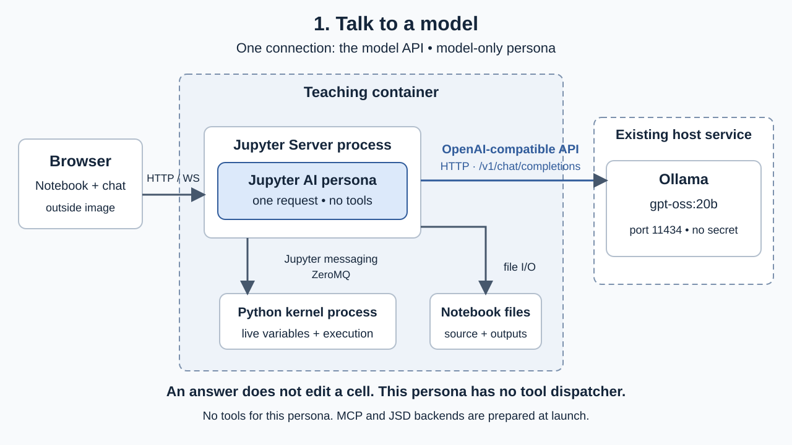
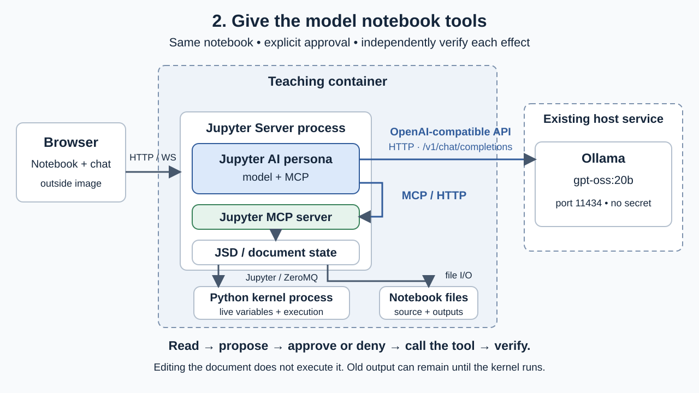
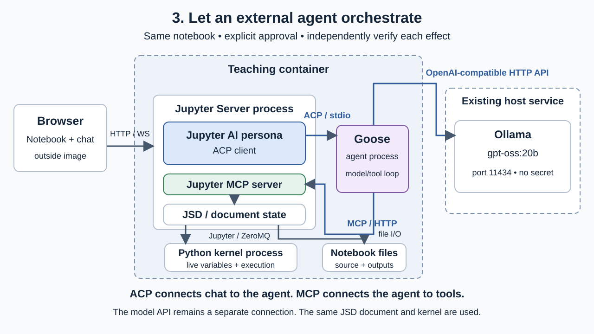

> **Trust but verify.** Rick's examples and AI-generated suggestions can be wrong or unsafe. Inspect code, configuration, file/tool access and network access; use disposable copies and verify results independently. Don't let an example eat your homework.

# One connection at a time: talk to a model

**Three-phase companion.** Watch the instructor's screen; no account or installation is needed. One prepared environment reveals model chat, notebook tools over MCP and Goose over ACP. The direct model-chat baseline was accepted; the complete progression still needs a live Mac rehearsal.



The browser shows the notebook and chat. **Jupyter Server** serves files, manages kernels and hosts the AI persona. The **kernel** is a separate Python process: it executes the notebook code and holds its live variables. A notebook file stores source and saved outputs. Its kernel can disappear while the file remains.

The **persona** is the code connecting chat to a model. Here it wraps one API call. **Ollama** is the selected provider service, `gpt-oss:20b` is the selected model ID, and the **OpenAI-compatible API** is the request/response contract. “OpenAI-compatible” does not mean the model runs at OpenAI. The model is outside the teaching image.

## Minimal → instrumented → components

1. Run the small notebook: `[2, 4, 6]` sums to `12`. Ask the model to explain the same three lines. The answer should describe the list, sum and printed total. **Static explanation by the author:** Python adds the three numbers and prints 12. This is an offline teaching answer, not a recorded model response.
2. Inspect the API shape below and [the small persona](container/persona/week3_chat/__init__.py). Find `messages`, `model` and `stream=False`. Nothing reads the notebook automatically: the instructor supplied the code as text. Sending a prompt runs server-side integration code, independently of executing a notebook cell.
3. Run the notebook's process/package cell. Its PID belongs to the kernel, not to Jupyter Server or the model host. Follow one source link below into a test. Compare how a public test establishes behavior with how we verified the local demonstration.

**Schema illustration, not a captured live exchange.** Content is omitted. After a successful live request, the persona shows a redacted summary beside the answer, including whether a tool call was returned; it never writes a raw HTTP trace. Move chat to the main area or widen it to read the summary. The synthetic HTTP test checks what the client actually sends, without contacting a model service. Private chat outputs must not be committed.

```json
{
  "request": {
    "method": "POST",
    "path": "/v1/chat/completions",
    "model": "gpt-oss:20b",
    "stream": false,
    "messages": [
      {"role": "system", "content": "<redacted>"},
      {"role": "user", "content": "<redacted>"}
    ]
  },
  "response": {
    "choices": [{"message": {"role": "assistant", "content": "<redacted>"}}]
  }
}
```

A sentence saying “I changed the cell” cannot change a cell in this configuration. There is no model tool list or dispatch loop. A person can still choose to copy suggested code into a notebook; that is a separate action needing review. Compare source, saved output and live variables independently.

## Where the software and people meet

| Component | Repository and code | One development artifact to inspect |
| --- | --- | --- |
| Browser notebook interface | [JupyterLab](https://github.com/jupyterlab/jupyterlab), notebook extension and services | [Notebook creation test](https://github.com/jupyterlab/jupyterlab/blob/v4.6.4/galata/test/jupyterlab/notebook-create.test.ts) |
| Server: files and kernel lifecycle | [Jupyter Server](https://github.com/jupyter-server/jupyter_server) | [Kernel service tests](https://github.com/jupyter-server/jupyter_server/tree/main/tests/services/kernels) |
| Python execution process | [ipykernel](https://github.com/ipython/ipykernel), `ipkernel.py` | [Kernel tests](https://github.com/ipython/ipykernel/blob/v6.30.1/tests/test_kernel.py) |
| Chat UI/file transport | [jupyterlab-chat](https://github.com/jupyterlab/jupyter-chat) | [Chat model test](https://github.com/jupyterlab/jupyter-chat/blob/main/python/jupyterlab-chat/jupyterlab_chat/tests/test_ychat.py) |
| Persona registration and routing | [persona manager](https://github.com/jupyter-ai-contrib/jupyter-ai-persona-manager), `base_persona.py` | [Base persona tests](https://github.com/jupyter-ai-contrib/jupyter-ai-persona-manager/blob/v0.2.2/jupyter_ai_persona_manager/tests/test_base_persona.py) |
| Jupyter AI package assembly | [Jupyter AI 3.2.0](https://github.com/jupyterlab/jupyter-ai/blob/v3.2.0/pyproject.toml) | [Release PR #1665](https://github.com/jupyterlab/jupyter-ai/pull/1665) |
| OpenAI-compatible client | [OpenAI Python SDK](https://github.com/openai/openai-python), chat completions resource | [Completion tests](https://github.com/openai/openai-python/blob/v2.3.0/tests/api_resources/chat/test_completions.py) |
| External model service | [Ollama](https://github.com/ollama/ollama), OpenAI compatibility layer | [Compatibility tests](https://github.com/ollama/ollama/blob/main/openai/openai_test.go) |

The persona calls the existing Ollama service on the instructor's laptop at `http://host.docker.internal:11434/v1/`, using [Ollama's documented OpenAI-compatible API](https://docs.ollama.com/api/openai-compatibility). The model and Ollama service remain outside the teaching container. The local API needs no provider secret.

**Optional participation:** observe a test before proposing code. Open the persona's `process_message()` and its upstream base-class test (about five minutes, browser only). Identify one assumption that needs a regression test—such as “an unavailable service should not reveal an error body.” An optional next action is a clear reproduction report with expected/observed behavior and versions. No GitHub account is needed to read.

## Add notebook tools over MCP



Switch the chat picker to **Notebook tools (MCP)**. Ask it to read **demo.ipynb**, change its last list value from 6 to 8, and leave it unexecuted. A real `tools/list` advertises three small teaching tools; a `tools/call` reads the cell. The model can propose an edit, but the persona waits for a separate human `approve` or `deny` message before making the MCP call. The proposed values are visible. Approval applies to one action and cannot be replayed.

These are deliberately narrow wrappers, not the full upstream notebook toolkit. They admit only one notebook/cell and arithmetic variants using 6 or 8. The [tool implementation](container/persona/week3_chat/notebook_tools.py) uses Jupyter AI tools and JSD, with no arbitrary path or code argument. The integration tests check the real protocol and live server document, rather than replacing MCP with direct Python calls.

An edit can leave old output **12** beside source `[2, 4, 8]`. The live kernel can also still hold `total = 12`. Ask to read and run the cell, review and approve the execution, and observe **14**. Independently compare saved source, saved output and kernel state using `bash week3/demo.sh inspect`.

**Illustrative protocol shape:** these are schemas, not a recorded model transcript. On screen, the persona displays the actual call's controlled values and result.

```json
{"method":"tools/list","names":["read_demo_cell","set_demo_value","run_demo_cell"]}
{"method":"tools/call","name":"set_demo_value","arguments":{"value":8,"expected_value":6},"result":{"executed":false}}
{"method":"tools/call","name":"run_demo_cell","arguments":{"expected_value":8},"result":{"output":"14"}}
```

The [Jupyter MCP server](https://github.com/jupyter-ai-contrib/jupyter-server-mcp) hosts the registered functions; see its [server tests](https://github.com/jupyter-ai-contrib/jupyter-server-mcp/blob/v0.3.0/tests/test_mcp_server.py). [JSD](https://github.com/jupyter-ai-contrib/jupyter-server-documents) owns the shared document and kernel connection; its [execution handler](https://github.com/jupyter-ai-contrib/jupyter-server-documents/blob/v0.3.3/jupyter_server_documents/execution_handlers.py) checks source hashes before enqueueing execution. JSD is an integration selected for this lesson, not a universal requirement of Jupyter AI.

## Add an external agent over ACP



Reset the repeated task with `bash week3/demo.sh lesson-reset`, run it for 12, create a fresh chat and select **Goose agent (ACP)**. Repeat the read/edit/run task, using the native permission cards to deny and then allow the reviewed action. Each Allow is per-action. No new installation or Jupyter restart is involved.

Now the Jupyter persona is an ACP client. The separate Goose process manages the model/tool loop. ACP carries the prompt, streamed replies, tool status and permission requests between Jupyter AI and Goose; Goose separately uses the model API and MCP. The model endpoint and notebook tools are shared with earlier phases. **ACP is not the model API, and not every connection uses every protocol.**

```json
{"protocol":"ACP","method":"session/new","agent":"Goose 1.54.0","mcp_server":"http://127.0.0.1:3001/mcp"}
{"protocol":"ACP","method":"session/prompt","prompt":"<redacted>"}
{"protocol":"ACP","method":"session/request_permission","decision":"allow_once or reject_once"}
{"protocol":"MCP","method":"tools/call","name":"run_demo_cell","arguments":{"expected_value":8}}
```

This is an illustration of the separate contracts. The UI's summaries and native tool cards show the actual session actions. Goose's other platform extensions are explicitly disabled, and its actual model-visible catalog is checked against the three workshop tools. ACP file and terminal capabilities are denied. The container still permits the instructor to run arbitrary Python manually; a limited persona is not a general sandbox.

Follow the [ACP client](https://github.com/jupyter-ai-contrib/jupyter-ai-acp-client/tree/v0.3.3/jupyter_ai_acp_client) to its [permission manager](https://github.com/jupyter-ai-contrib/jupyter-ai-acp-client/blob/v0.3.3/jupyter_ai_acp_client/permission_manager.py), then inspect [Goose's ACP implementation](https://github.com/aaif-goose/goose/tree/v1.54.0/crates/goose/src/acp). Our [integration check](tests/integration.py) uses the real Goose binary, MCP server and JSD against a synthetic model endpoint, including denial and approval. Synthetic output is never presented as live model evidence.

## Static fallback and participation

If a live service fails, run the arithmetic manually and use the three diagrams and protocol illustrations to explain the intended connections. Label which steps were actually observed. The static answer remains: `[2, 4, 6]` sums to 12; `[2, 4, 8]` sums to 14. Watching and reading require no account, model access or installation. Student-directed questions and projects remain the second half; no prepared demonstration spills into that time.
